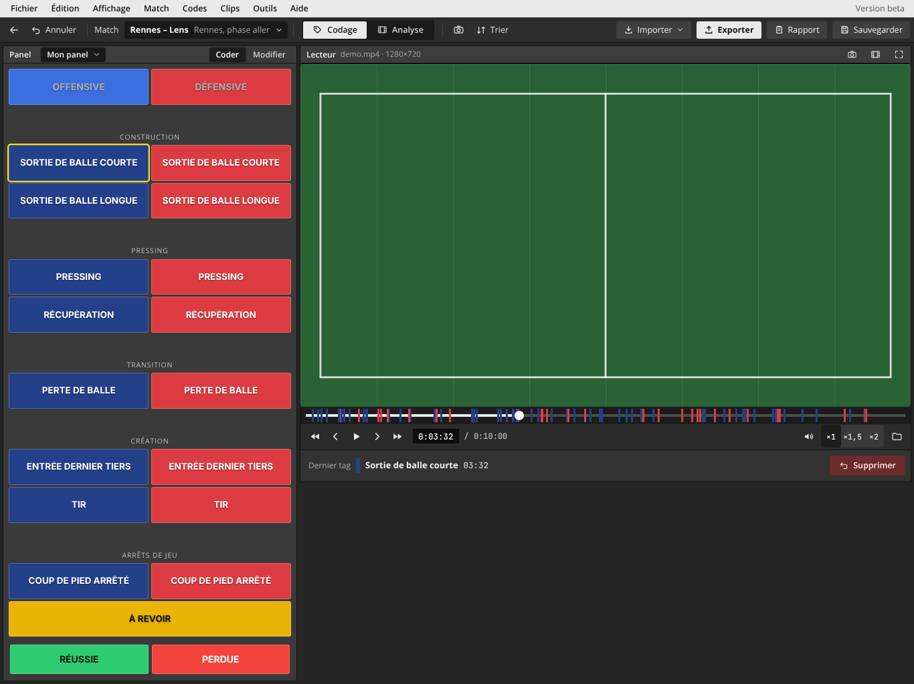
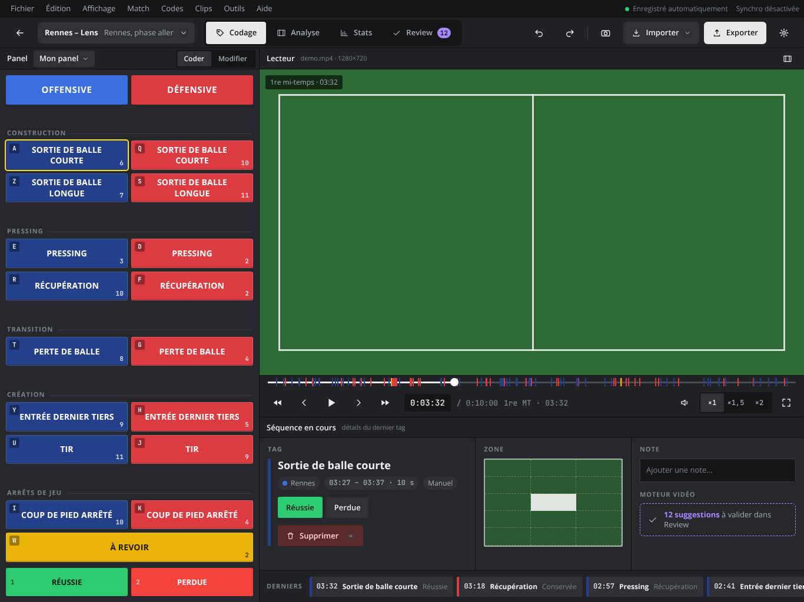
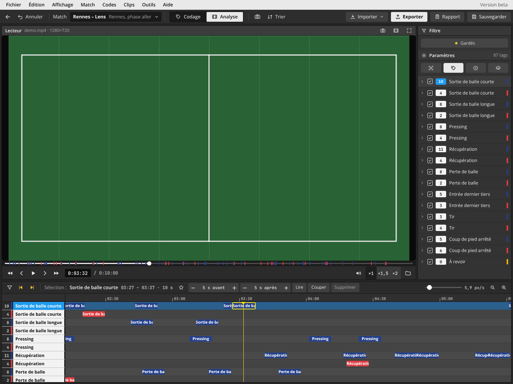
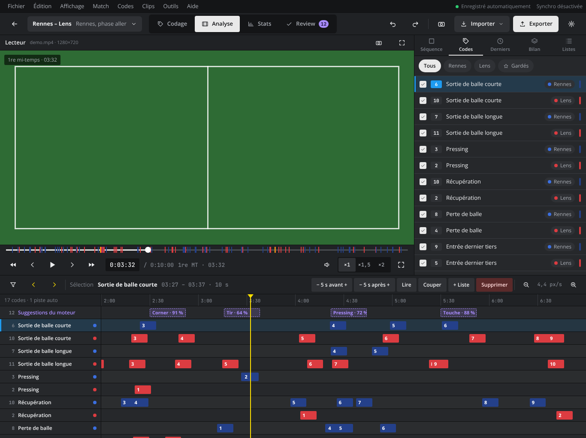

# RL Analysis v3 — Étape 2 : architecture et maquette

## 1. Principes
- **100 % statique** : HTML, CSS, JavaScript. Aucun serveur, aucune dépendance à télécharger pour utiliser l'appli.
- **Aucune étape de compilation pour développer** : modules JavaScript natifs. Un petit script (`tools/build.mjs`, Node, sans dépendance) assemble une **version en un seul fichier** pour l'usage « j'ouvre le fichier sur mon ordinateur » (les navigateurs refusent les modules séparés ouverts depuis le disque).
- **Un seul fichier de thème** (`app/css/theme.css`) : toutes les couleurs, tailles et rayons. Les composants n'utilisent que ces variables.
- **Données sur l'appareil** (IndexedDB), vidéos dans le stockage privé du navigateur (comme aujourd'hui). Rien n'est envoyé ailleurs, sauf si tu actives la synchro.
- **Le moteur vidéo est séparé** (Python, Colab). L'appli ne fait que lire son fichier JSON.

## 2. Arborescence

```
v3/
├── app/                         ← l'application (ce qu'on dépose sur Netlify / Cloudflare)
│   ├── index.html               ← squelette des écrans
│   ├── manifest.webmanifest     ← installation iPad (PWA)
│   ├── sw.js                    ← fonctionnement hors ligne
│   ├── fonts/  icons/
│   ├── css/
│   │   ├── theme.css            ← SEUL endroit avec des couleurs
│   │   ├── base.css             ← remise à zéro, typographie, boutons, champs
│   │   └── components/          ← un fichier par composant (panel.css, timeline.css…)
│   └── js/
│       ├── main.js              ← démarrage, navigation entre écrans
│       ├── core/
│       │   ├── store.js         ← IndexedDB, sauvegarde automatique (après chaque action)
│       │   ├── history.js       ← annuler / rétablir (pile de 100 actions par match)
│       │   ├── bus.js           ← événements internes (une modif → les vues concernées se redessinent)
│       │   ├── shortcuts.js     ← raccourcis clavier modifiables
│       │   ├── video-store.js   ← vidéos gardées sur l'appareil (repris de l'existant)
│       │   └── sync.js          ← synchro Supabase, désactivée par défaut
│       ├── model/               ← match, tag, panel, projet, liste (règles pures, testables)
│       ├── io/
│       │   ├── legacy-import.js ← tes sauvegardes actuelles (« carnet-de-tags »), sans perte
│       │   ├── project-file.js  ← export / import d'un projet complet v3
│       │   ├── csv.js           ← export CSV (mêmes colonnes qu'aujourd'hui) + import CSV de stats
│       │   └── engine-import.js ← fichier JSON du moteur vidéo → tags suggérés + données de stats
│       ├── stats/               ← calculs (possession, passes, zones…), sans affichage, testés
│       └── ui/
│           ├── views/           ← home, projects, new-match, coding, analysis, stats, review, panel-editor, sort, settings
│           └── components/      ← player, transport, code-pad, timeline, codes-list, sequence, lists, dialogs, toast, stat-cards
├── engine/                      ← moteur d'analyse vidéo (Python)
│   ├── rl_engine/               ← un module par étape (preprocess, players, pitch, ball, possession, events, passes, maps)
│   ├── notebooks/RL_Analysis_Colab.ipynb
│   ├── schema/engine-output.schema.json   ← contrat entre le moteur et l'appli
│   └── tests/
├── tests/                       ← tests JS (node --test) : modèle, import, CSV, stats, historique
├── tools/build.mjs              ← assemble dist/RL-Analysis.html (un seul fichier)
├── dist/                        ← résultat du build (fichier unique + dossier à déposer)
├── maquette/                    ← maquette statique de l'étape 2
└── docs/                        ← inventaire, architecture, guides d'installation, rapports
```

## 3. Données (IndexedDB, base `rl-analysis`)

| Table | Clé | Contenu |
|---|---|---|
| `matches` | id | Match (même champs qu'aujourd'hui) + `venue` calculé (domicile / extérieur pour « Mon équipe ») |
| `tags` | id, index par match | Tag actuel + `source` (`manual` / `auto`), `status` (`accepted` / `suggested` / `rejected`), `conf` (0–1), `module` |
| `projects` | id | Projet + **`myTeam`** (« Mon équipe »), `stars`, `last` |
| `panels` | id | Bibliothèque de panels (chaque bouton reçoit un **champ équipe visible** et un **raccourci**) |
| `lists` | id | Listes de lecture (réactivées) |
| `stats_manual` | id | Saisies et imports CSV pour ce qui manque (source « Manual ») |
| `engine_runs` | id | Résultats bruts du moteur par match (positions, possession, zones…) |
| `corrections` | id | Chaque acceptation / rejet / correction d'une suggestion → précision par module |
| `settings` | clé | Raccourcis, séparateur CSV, zoom, synchro (désactivée par défaut) |

Les tags sont stockés un par un (et non tout le match d'un bloc) : sauvegarde instantanée même avec 500+ tags.

**Migration de l'existant** : au premier lancement, si l'ancien stockage (`carnet-de-tags.v1`) est présent sur le même site, il est copié automatiquement. Sinon (nouvelle adresse Netlify, iPad), import du fichier « Tout sauvegarder ». L'import v3 reprend **tout** : matchs avec leur date de création, tags, projets, clips gardés, bibliothèque de panels, listes. Un rapport d'import affiche les nombres (ex. « 6 matchs, 488 tags, 2 projets, 3 panels ») avant de valider.

## 4. Performance (500+ tags)
- **Timeline** : les blocs sont dessinés sur un `<canvas>` (une seule surface, quel que soit le nombre de tags) ; les noms de lignes restent en HTML. Seule la partie visible est dessinée.
- Listes longues (codes, derniers tags, Review) : n'affichent que les lignes visibles.
- Redessin ciblé : ajouter un tag ne redessine que la piste et le compteur concernés.
- Objectif mesuré à l'étape 3 : < 16 ms par ajout de tag avec 2 000 tags sur iPad.

## 5. Annuler / Rétablir
Chaque action (ajouter, supprimer, déplacer, rogner, couper un clip, changer résultat / zone / note, changer de période, modifier le panel) est une « commande » réversible. ⌘Z / Ctrl+Z annule, ⇧⌘Z / Ctrl+Y rétablit, boutons dans la barre d'outils. Le toast « Annuler » actuel est gardé.

## 6. Raccourcis clavier (par défaut, modifiables dans Réglages)
Les touches sont repérées par leur **position** sur le clavier : elles marchent en AZERTY comme en QWERTY.

| Action | Défaut |
|---|---|
| Lecture / pause | Espace |
| −5 s / +5 s | ← / → |
| −20 s / +20 s | ⇧← / ⇧→ |
| Vitesse ×1 / ×1,5 / ×2 | , / ; / : |
| Coder un bouton | Colonne gauche du panel : A Z E R T Y U I… ; colonne droite : Q S D F G H J K… ; « À revoir » : W |
| Résultat 1 à 4 du tag en cours | 1 2 3 4 (sans Maj) |
| Supprimer le dernier tag | ⌫ |
| Clip précédent / suivant | P / N |
| Accepter / rejeter la suggestion (Review et timeline) | Entrée / Suppr |
| Annuler / rétablir | ⌘Z / ⇧⌘Z |

Chaque bouton du panel affiche sa touche dans un coin. Avec un clavier sur iPad (Magic Keyboard), tout fonctionne aussi.

## 7. Contrat avec le moteur vidéo
`engine/schema/engine-output.schema.json` (version 1) : informations sur la vidéo (durée, images/s, intervalles ignorés : rediffusions, plans serrés), et pour chaque module : `events[]` (type, temps, équipe, zone, **confiance**, ou `"non détecté"`), séries de possession, zones (grilles 3×5 et 12×8), passes estimées, et un bloc `quality` (précision mesurée, limites). L'appli refuse un fichier d'une version inconnue et ne fabrique jamais de valeur absente.

## 8. Écrans
Accueil · Nouveau match · Mes projets · **Codage** · **Analyse** · **Stats** (nouveau) · **Review** (nouveau) · Modifier le panel · Trier · **Réglages** (nouveau : raccourcis, synchro, stockage).

## 9. Maquette avant / après
Captures à 1366 × 1024 (iPad Pro 12,9″ en paysage), avec des données de démonstration. Les « avant » viennent de ton appli actuelle.

| | Avant | Après |
|---|---|---|
| Codage |  |  |
| Analyse |  |  |

Maquette ouvrable : `v3/maquette/index.html?s=code` et `?s=ana`.

### Changements importants
**Partout**
1. Barre de menus sombre et discrète (au lieu du bandeau blanc), qui affiche « Enregistré automatiquement » et l'état de la synchro.
2. Barre d'outils plus haute (52 px), toutes les cibles font au moins 44 px pour l'iPad. Onglets **Codage · Analyse · Stats · Review** (le compteur violet donne le nombre de suggestions à valider). **Annuler / Rétablir** en icônes.
3. « Sauvegarder » quitte la barre (la sauvegarde est automatique ; l'action reste dans Fichier). « Rapport » devient l'onglet **Stats** (le Bilan reste dans Analyse).
4. Un seul thème, une seule échelle d'espacement (4 / 8 / 12 / 16 px), en-têtes de panneau de 36 px partout.

**Codage**
5. L'espace vide sous la vidéo devient un panneau **« Séquence en cours »** (comme les détails de séquence de LiveTag) : nom, équipe, début – fin, source (Manuel / Auto), résultats, zone, note, Supprimer, et l'accès aux suggestions. En bas, une bande des **derniers tags**.
6. Boutons du panel : touche du raccourci en haut à gauche, nombre de tags en bas à droite, léger relief pour l'état « appuyé ». Titres de groupes alignés à gauche avec un filet. Les titres « Offensive / Défensive » ne paraissent plus désactivés. **Disposition, noms et couleurs inchangés.**
7. Résultats (Réussie / Perdue) avec leur touche 1 / 2.

**Analyse**
8. Onglets de la colonne de droite **avec leur nom** (Séquence, Codes, Derniers, Bilan, **Listes**). Filtres en puces : Tous / Rennes / Lens / Gardés.
9. Chaque code indique son équipe (puce colorée) : les deux « Sortie de balle courte » ne se confondent plus.
10. Timeline : pistes de 30 px au lieu de 22 px, noms entiers (colonne de 236 px), règle lisible, blocs numérotés.
11. Une piste **« Suggestions du moteur »** en violet pointillé, avec le pourcentage de confiance.
12. Barre de la timeline : actions sur le clip regroupées à droite, « + Liste » ajouté, Supprimer en rouge.

## 10. Ordre de construction (rappel)
3) reconstruction à fonctions identiques → 4) habillage ci-dessus → 5) hors GitHub, iPad, import de l'existant → 6) Stats → 7) faisabilité du moteur sur ton extrait → 8–9) modules → 10) non-régression et rapport.
