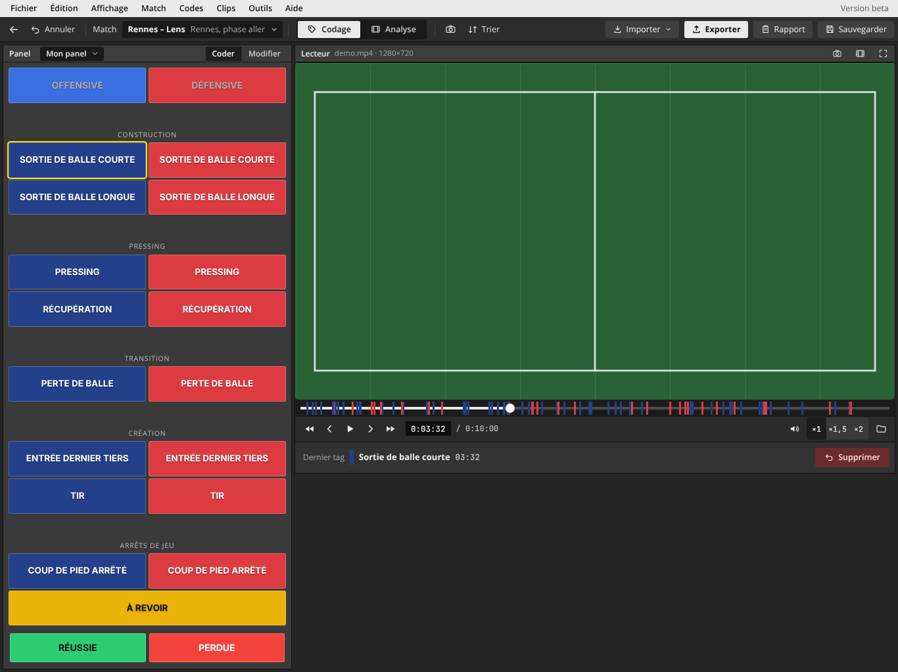
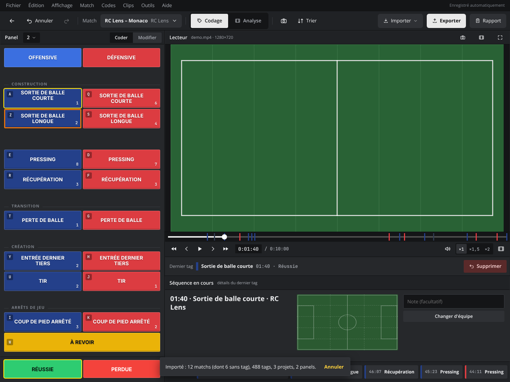
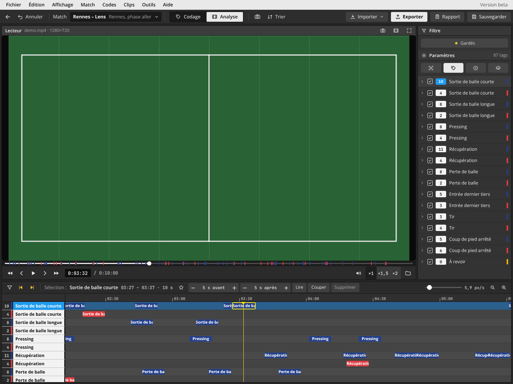
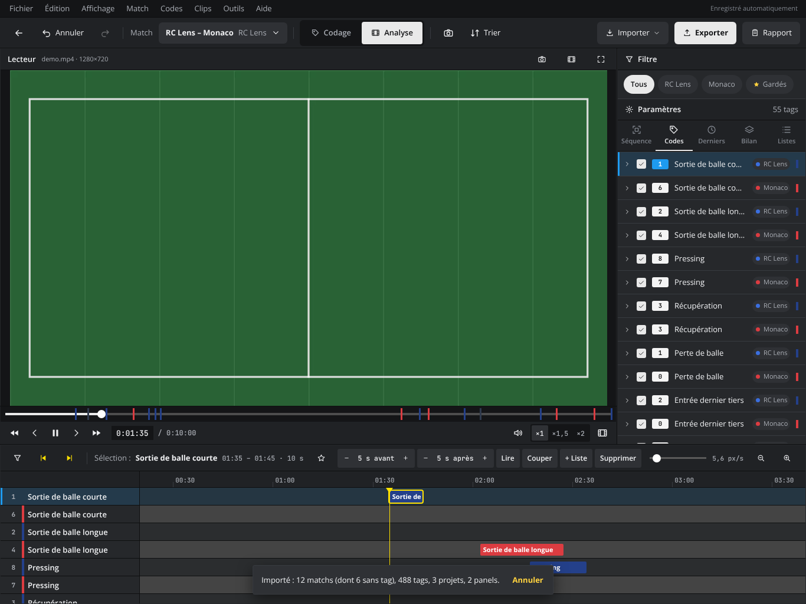

# RL Analysis v3 — Étape 4 : design appliqué

Même fonctions qu'à l'étape 3 (tests inchangés : 11 tests + parcours navigateur, tous passent). Seuls l'apparence et quelques ajouts d'affichage changent.

| | Avant (appli actuelle) | Après (v3) |
|---|---|---|
| Codage |  |  |
| Analyse |  |  |

## Changements
1. **Page Codage** : le vide sous la vidéo devient « Séquence en cours » (dernier tag, terrain des zones, note, changement d'équipe) avec la bande des 6 derniers tags. Les boutons du panel affichent leur **touche** (haut gauche) et leur **nombre de tags** (bas droite) ; titres de groupe avec filet ; relief « appuyé ».
2. **Page Analyse** : onglets de droite **nommés** (Séquence, Codes, Derniers, Bilan, Listes) ; **filtres en puces** (Tous / équipe 1 / équipe 2 / Gardés) ; **puce d'équipe** sur chaque code ; colonne élargie à 320 px pour lire les noms entiers.
3. **Timeline** : pistes de 30 px, noms de 236 px, sélection surlignée en bleu, règle plus lisible.
4. **Tactile** : barres et boutons d'au moins 40–44 px ; en-têtes de panneaux de 36 px ; menus de 30 px.
5. **Un seul thème** (`app/css/theme.css`) : couleurs, tailles, rayons, espacements.

## Pas encore fait
- Onglets **Stats** et **Review** de la barre d'outils : ils n'apparaîtront que quand leur contenu existera (étapes 6 et 9), pour ne pas afficher de bouton qui ne fait rien.
- Timeline dessinée en canvas : pas nécessaire tant que les mesures iPad restent bonnes.
- Pas de thème clair (décision de l'étape 1).
